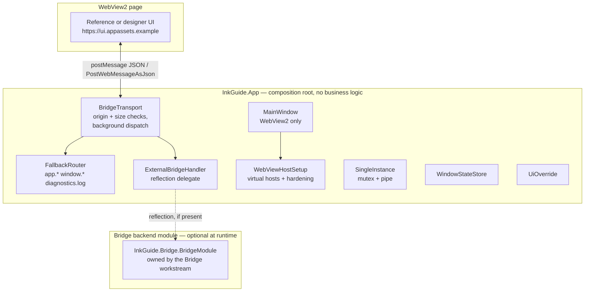

# InkGuide — ARCHITECTURE

> Host + packaging view. For the domain/data/sync design, see the persistence,
> storage, analysis, bridge and UI owners' sections (linked at the bottom).
> This document matches the code as shipped by the host/tools/packaging workstream.

## Runtime picture

## Projects and layering (MASTER_PROMPT Section 6.2)

| Project | May reference | Role |
|---|---|---|
| `InkGuide.Domain` | nothing | Entities, Result/Error |
| `InkGuide.Application` | Domain | Ports + use cases |
| `InkGuide.Analysis` | Domain, Application | Insight/detectors/tags |
| `Infrastructure.*` | Domain, Application | SQLite, Drive, platform |
| `InkGuide.Bridge` | Application, Domain | Contracts, dispatcher, handlers — no WPF/WebView2 |
| `InkGuide.App` | everything | **Composition root only** (windowing, WebView2, transport) |
| `InkGuide.Tools` | everything | contract-gen, live-check, seed-fixtures |

Google SDK types never leave `Infrastructure.Storage/GoogleDrive`.
`localStorage` holds disposable caches only; durable UI state goes through
`settings.getUiState/setUiState`.

## Bridge transport (App side)

- `BridgeTransport` owns the WebView2 message pump: `WebMessageReceived` runs
  on the UI thread, verifies `e.Source` against the UI virtual host
  (`https://ui.appassets.example`) or the active `--ui-dev-url` origin, drops
  messages over 1 MB, and dispatches `req` handling to background threads.
  Replies re-enter the UI thread for `PostWebMessageAsJson`.
- Cancellation: `{type:"cancel", id}` cancels the in-flight `CancellationTokenSource`.
- Host-to-UI events are coalesced per topic (≥ 100 ms) in `EmitEventAsync`.
- Drag-and-drop: `postMessageWithAdditionalObjects` file entries arrive as
  `CoreWebView2File.Path`; `DragDropHandler` validates existence/readability,
  expands directories recursively (cap 5000 entries), and rejects any path
  under a reparse point. Validated paths are routed as `transfers.uploadPaths`.

## Host-owned vs backend-owned methods

`FallbackRouter` answers `app.hello/getInfo/getUiStatus/openLogsFolder/
openExternalUrl/quit/restart`, `window.setBackground/setTitle`, and
`diagnostics.log` (with secret redaction). Everything else is delegated to the
backend module when loaded, otherwise answered with a typed `UNKNOWN`
("not served by this host build") error — an explicit state, never a throw.

## Bridge backend discovery contract

Because `InkGuide.Bridge` must not reference WPF, and the host must build
before the contracts land, `BridgeModuleLoader` discovers the backend by
reflection (logged, optional). The Bridge workstream implements:

- type `InkGuide.Bridge.BridgeModule` (public static class);
- `public static void Configure(IServiceCollection services)` (optional):
  registers backend services used internally by the module;
- `public static bool CanHandle(string method)`;
- `public static Task<string?> HandleAsync(string method, string paramsJson, CancellationToken ct)`
  returning result-payload JSON, or `null` when not served;
- typed failures throw `InkGuide.Bridge.BridgeMethodException` with
  `string Code`, `string Message`, `bool Retryable`.

`CliOptions` is registered as a singleton, so the backend can read
`--local-provider` / `--data-dir` without its own CLI parsing.

## WebView2 hardening map

| Requirement | Implementation |
|---|---|
| User-data folder | `%LOCALAPPDATA%\InkGuide\webview2` (or `--data-dir`) |
| Missing runtime | `GetAvailableBrowserVersionString` probe → native MessageBox + Evergreen link, never crash |
| Virtual hosts | `ui` → UI folder (`Deny`); `cache` → content cache (`DenyCors`); `usercontent` → preview cache (`DenyCors`) |
| Navigation allowlist | `NavigationStarting` + `FrameNavigationStarting` cancel anything outside the three hosts (+ dev origin in Debug) |
| Popups | `NewWindowRequested`: `http/https/mailto` → system browser, else blocked; always `Handled` |
| Permissions | `PermissionRequested` → denied |
| Downloads | `DownloadStarting` → cancelled, handed to the app transfer flow |
| Host objects / chrome | `AreHostObjectsAllowed=false`, status bar off, password/autofill off |
| Devtools/menu/keys/zoom | settings-driven (`INKGUIDE_DEVTOOLS/CONTEXT_MENU/ACCELERATORS/ZOOM` override; Debug defaults on, Release off) |
| Renderer crash | `ProcessFailed` → throttled auto-reload (3/min) + log |
| Single instance | `Local\inkguide.desktop` mutex; second launch forwards args over `inkguide.desktop.ipc` pipe and activates the first window |
| Window state | `window-state.json`, restored only if inside the virtual screen |
| Crash handling | Dispatcher/AppDomain/TaskScheduler hooks; log, minimal dialog, outbox (DB) untouched |
| Flash avoidance | neutral `#F0F0F0` background, overridable via `window.setBackground` |

## Folders (`%LOCALAPPDATA%\InkGuide\`, overridable)

`data\` (SQLite), `cache\content\`, `cache\preview\`, `external\`, `logs\`
(Serilog 10 MB × 10), `webview2\`, `rules\`, `ui-override\`, `secrets\`,
`settings.json`, `window-state.json`. `--portable` (or `portable.flag`) moves
the base next to the exe. `--reset` clears cache/settings/window-state after a
native confirmation; the database (outbox included) and secrets are preserved.

## Tools

- `contract-gen`: reflects `InkGuide.Bridge.dll` DTOs + baseline catalog →
  `ui/src/core/contract.ts` + `docs/BRIDGE_PROTOCOL.md`; `--check` fails the
  build on stale output. Hand-maintained TS may live after the marker line
  `// --- UI compatibility layer (preserved across contract-gen runs) ---`;
  the generator carries that tail forward verbatim.
- `live-check`: smoke steps on a dedicated `InkGuide-LiveCheck-<timestamp>`
  folder (LocalFolder backend fully; Drive backend reports config state).
- `seed-fixtures`: deterministic analysis fixture trees (8 kinds, 30 files).

## Packaging

`build\publish.cmd [version]` → self-contained `win-x64` folder publish
(ReadyToRun, no trim — WebView2Loader.dll verified present) + UI/config copy →
`dist\InkGuide-{ver}-win-x64\` + ZIP + `SHA256SUMS.txt`. `installer\setup.iss`
is a per-user Inno script (`%LOCALAPPDATA%\Programs\InkGuide`, optional
WebView2 bootstrapper, uninstall asks about user data). `build\sign.cmd` signs
when a thumbprint/PFX is configured, otherwise prints how.

## Related documents (other workstreams land these)

- `docs/BRIDGE_PROTOCOL.md` (generated + prose) — full method/error catalog.
- `docs/UI_CONTRACT.md`, `docs/UI_REPLACEMENT_GUIDE.md` — UI workstream stubs in this tree.
- Domain/persistence/storage/analysis specifics — their owners' docs.
